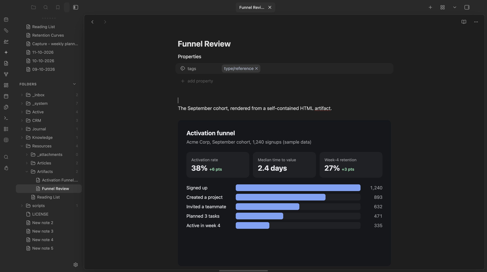
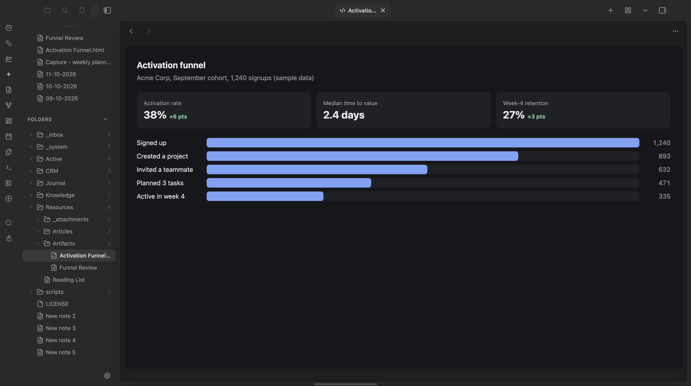

# Artifacts

View, embed, and screenshot self-contained HTML artifacts inside Obsidian.

Consolidates three previously-separate plugins into one:
- Standalone tab view for `.html`/`.htm` files (default reader)
- Inline embedding via `![[artifact.html]]`
- Auto-reload when the source file changes
- Desktop-only "Screenshot artifact to PNG" command

## Screenshots

<p align="center">
  
</p>
<p align="center"><em>An HTML artifact embedded inline with <code>![[Activation Funnel.html]]</code>.</em></p>

<p align="center">
  
</p>
<p align="center"><em>The same file opened directly, as a standalone tab.</em></p>

## Development

```bash
pnpm install
pnpm dev     # watch build, deploys to the path in .obsidian-plugin-dir
pnpm build   # production build
pnpm test    # unit tests (pure logic only)
```

## Try it

See it running in the [Obsidianverse sample vault](https://github.com/mariomile/obsidianverse-sample-vault), a small, fictional vault with the whole plugin suite pre-configured.

